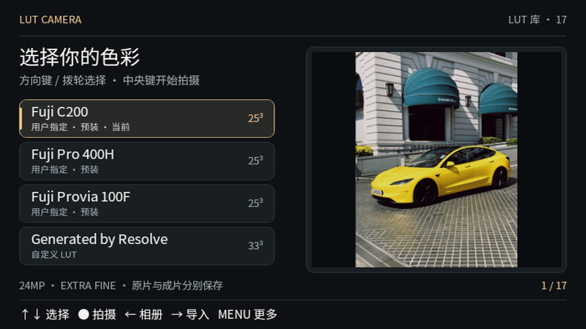

<div align="center">

# LUT Camera

**在 Sony 相机里直接完成 3D LUT 调色：一次拍摄，同时得到原片和调色成片。**

不需要手机、电脑或联网。

[](https://github.com/EnglandLobster/sony-lut-camera/releases)
[](LICENSE)
[](docs/compatibility/README.md)

**[⬇ 下载 v0.9.1 APK](https://github.com/EnglandLobster/sony-lut-camera/releases/download/v0.9.1/SonyLutCamera-v0.9.1.apk)** · [发行说明](https://github.com/EnglandLobster/sony-lut-camera/releases/tag/v0.9.1) · [安装教程](docs/USER_GUIDE.md) · [反馈问题](https://github.com/EnglandLobster/sony-lut-camera/issues)



</div>

## 特性

- **完整 3D LUT 成片**：保存的照片按完整网格逐像素调色，不是近似滤镜。
- **原片与成片各存一份**：未套 LUT 的原片 JPEG 和调色 JPEG 分别保存到 SD 卡。
- **全尺寸、最高画质**：使用本机原生比例的最大尺寸（A6300 为 6000×4000），自动选择机身支持的最高 JPEG 档位。
- **导入自己的 LUT**：支持 2–65³ 的 `.cube`，单个文件最大 64 MiB，按内容去重。
- **预装 10 个胶片风格 LUT**：Fuji、Ilford、Kodak、Ricoh，默认 Fuji C200，见[内置 LUT](docs/BUILTIN_LUTS.md)。
- **近似实时取景**：导入时自动拟合相机原生色彩参数，取景接近成片效果；也可以改用原色取景。
- **应用内相册**：随时切换原片和成片对比。

## 安装

1. 从[发行页](https://github.com/EnglandLobster/sony-lut-camera/releases/tag/v0.9.1)下载 `SonyLutCamera-v0.9.1.apk`。注意选 `.apk`，`Source code` 压缩包不是安装包。
2. 相机 USB 连接设为 MTP，用 [Sony-PMCA-RE](https://github.com/ma1co/Sony-PMCA-RE) 安装这个 APK。
3. 在相机的应用程序列表里打开 **LUT Camera**。第一次打开时会把预装 LUT 写入 SD 卡，稍等片刻。

第一次安装建议看 **[新手安装与使用教程](docs/USER_GUIDE.md)**：里面有 Windows / macOS 工具下载、相机设置、逐步截图和常见问题。新版本可以直接覆盖安装，LUT 库和照片都会保留。

## 支持机型

能安装 PMCA 应用的 Sony 机型基本都已适配，共 27 款：

| 系列 | 机型 |
| --- | --- |
| 全画幅 α7 | A7、A7 II、A7R、A7R II、A7S、A7S II |
| APS-C α | A5000、A5100、A6000、**A6300** ✅、A6500 |
| NEX | NEX-5R、NEX-5T、NEX-6 |
| RX | RX100 III、RX100 IV、RX100 V、RX10 II、RX10 III †、RX1R II † |
| HX / WX | HX60 †、HX60V、HX90 †、HX90V †、HX400 †、HX400V、WX500 † |

- ✅ 已完成实拍验证（A6300，固件 2.01）。
- 其他机型按各自机身的传感器尺寸、内存配置和保存协议接入，全尺寸成片与双文件保存的流程相同，实拍验收还在陆续进行。
- † 暂未取得官方固件做本地回归，运行时按机身实际配置自动选择。
- A68、A77 II、A99 II、RX100 II、初代 RX10 尚未确认能否安装 PMCA 应用。

逐机型细节见[机型范围](docs/compatibility/README.md)和[逐项清单](docs/compatibility/RECIPE_TARGETS.md)。用你的机型拍过的话，无论成功还是遇到问题，都欢迎[反馈](#反馈问题)。

## 使用

在 LUT 库选好 LUT，按中央键进入取景。之后像平常一样半按对焦、全按拍照，处理完成后屏幕会显示成片，半按快门回到取景。

| 页面 | 按键 | 作用 |
| --- | --- | --- |
| LUT 库 | 上 / 下、拨轮 | 选择 LUT，右侧参考图同步显示效果 |
| | 中央键 | 进入拍摄 |
| | 左 / 右 | 打开相册 / 导入 LUT |
| | MENU | 更多：取景方式、导出诊断日志、退出应用 |
| 取景 | 半按 / 全按快门 | 对焦 / 拍摄 |
| | 模式转盘 | P / A / S / M，跟随机身转盘 |
| | 拨轮 | 按档位调光圈、快门或曝光补偿（见下表） |
| | 右 | ISO 列表 |
| | 左 | 白平衡列表 |
| | 下 | 对焦设置：移动对焦点、对焦区域、人脸优先 |
| | 中央键 | 曝光补偿归零 |
| | DISP | 切换信息显示 |
| | 播放键 | 打开应用内相册 |
| 相册 | 左 / 右 | 较早 / 较新的照片 |
| | 中央键 | 切换原片和成片 |
| | 半按快门 | 返回拍摄 |

A6300 / A6000 这类「上拨盘 + 控制轮」的机身，拨轮按档位分工：

| 档位 | 上拨盘 | 控制轮 |
| --- | --- | --- |
| P | 曝光补偿 | 曝光补偿 |
| A | 光圈 | 曝光补偿 |
| S | 快门 | 曝光补偿 |
| M | 光圈 | 快门 |

有前后拨轮的机身（如 A7 系列），控制轮另外调 ISO。没有模式转盘的机身在「下 → 曝光模式」里选择档位。转盘在 AUTO、SCN、MR 等位置时按 P 拍摄，屏幕会提示。M 档固定 ISO 时不使用曝光补偿。

列表里用上 / 下或拨轮选择，中央键确定，MENU 返回。对焦设置里，中央键打开该项的选项列表，左 / 右可以不打开列表直接切换；在对焦区域里选「自由点」并确定后，直接进入移动对焦点。移动对焦点时用方向键或拨轮移动方框，中央键保存，MENU 取消。半按合焦后，对焦位置显示绿框，左下角亮绿点。档位、ISO、白平衡、曝光补偿、各档的光圈 / 快门和对焦设置会记住，下次进入时恢复；退出应用时相机恢复你原来的设置，模式跟随转盘当前位置。

要回到 Sony 原生拍摄，按 MENU 回到 LUT 库，再选 **更多 → 退出应用**。

## 导入自己的 LUT

> [!IMPORTANT]
> **复制到相机前，先把文件名改成 DOS 8.3 格式**：主名 1–8 个字符，扩展名用 `.CUB`，建议只用大写字母和数字。
> 例如 `CV-Fuji-3513-V1.cube` → `FUJI3513.CUB`。文件名过长，或者用了 4 个字符的 `.cube` 扩展名，相机都会扫描不到。只需要改文件名，不要改文件内容。

1. 把改好名的文件直接放进 SD 卡根目录的 `LUTS/` 文件夹（`LUT/` 也可以，大小写不限），不要放在子文件夹里。
2. 在 LUT 库按右键扫描，选择全部导入或单个导入。
3. 导入完成后选中即可拍摄。库里显示的名字来自文件内的 TITLE，可能和文件名不同。

适合使用面向普通照片的风格 LUT；Log 转换类 LUT 需要匹配的 Log 输入，直接套在普通照片上颜色会不对。

## 须知

- **取景是近似效果，成片才是完整 LUT。** 拟合误差较大的 LUT 会提示你选择继续近似预览或改用原色取景，每个 LUT 单独记忆（LUT 库 → MENU → 当前 LUT 的取景）。
- 拍一张需要几秒钟处理，时间取决于场景和 SD 卡速度。处理期间不能连拍。
- “原片”是未套 LUT 的 JPEG，不是 RAW。
- 不支持视频 LUT，也没有全分辨率的实时 LUT 取景。
- 正常拍摄不需要“测试连接”、ADB 或 Wi-Fi，这些只用于开发。

## 反馈问题

出现异常时，在应用里选 **MENU → 导出诊断日志**，SD 卡上会生成 `SONYLUT/DIAG/REPORT.ZIP`。请把它和下面这些信息一起发到 [Issues](https://github.com/EnglandLobster/sony-lut-camera/issues)：

- 机型、固件版本、应用版本
- 出问题前做了什么、停在哪个画面

日志不包含照片和 LUT 内容，也不会自动上传。详见[诊断日志说明](docs/DIAGNOSTICS.md)。

## 版本动态

**v0.9.1**

- 新增删除自己导入的 LUT：LUT 库选中后按 MENU → 更多 → 删除当前 LUT。
- 修复导入不同 LUT 后名称全都一样（例如都显示「Generated by Resolve」）。
- 应用包名改为 `io.github.englandlobster.lutcamera`：安装后新版不会覆盖旧版，需要删除旧版，见[发行说明](docs/RELEASE.md)。

**v0.9.0-beta.9**（预发行测试版）

- 修复 A6000 等旧机型在相机回放里删掉最新照片后，回到应用拍第一张仍停在“正在核验照片保存”的问题（[#7](https://github.com/EnglandLobster/sony-lut-camera/pull/7)）。

**v0.9.0-beta.8**

- 修复 A6000 等旧机型在照片索引与卡上文件不一致时，仍停在“正在核验照片保存”的问题（[#6](https://github.com/EnglandLobster/sony-lut-camera/pull/6)）。
- 修复拍完立刻导出诊断日志时，第一次总是失败的问题（[#3](https://github.com/EnglandLobster/sony-lut-camera/issues/3)）。
- 补充 LUT 文件名必须符合 DOS 8.3 的说明。

A6000 等旧机型的修复还没有用发行包实拍确认。历史版本见 [CHANGELOG](CHANGELOG.md) 和[发行记录](docs/RELEASE.md)。

## 开发

原始代码采用 GPL-3.0-only。已验证的构建主机为 macOS 和 Linux x86_64，需要 JDK 17、Android SDK 36 和 NDK r16b；外部依赖由脚本按固定版本获取。

```sh
python3 scripts/bootstrap_dependencies.py
bash scripts/build_host.sh
python3 scripts/test_offline.py
bash scripts/test_product_ui.sh
bash scripts/build_android.sh --release
```

[构建说明](docs/BUILD.md) · [架构](docs/ARCHITECTURE.md) · [页面与操作规则](PRODUCT_UI.md) · [当前状态](docs/STATUS.md) · [贡献规范](AGENTS.md)

| 目录 | 内容 |
| --- | --- |
| `android/` | 产品页面、拍摄、预览、存储与 Sony 接口（`app`、`capture`、`preview`、`storage`、`ui`、`platform`） |
| `native/` | C++ 完整 LUT、UYVY、JPEG、缓存与预览拟合 |
| `android-assets/` | 预装 LUT、参考缩略图、字体及来源说明 |
| `android-tests/`、`scripts/` | 测试、构建与维护脚本 |
| `android/diagnostics/`、`native/probes/` | 开发诊断，发行 APK 不包含 |
| `dev-connect/` | 可选的开发连接工具，拍摄不依赖它 |
| `docs/` | 用户指南、构建、架构、机型适配与发行记录 |

## 许可与致谢

本项目原始代码以 [GPL-3.0](LICENSE) 发布；预装 LUT、字体、照片和外部配置分别遵循[资源许可说明](ASSET_LICENSES.md)与[第三方清单](THIRD_PARTY_NOTICES.md)。

感谢 [OpenMemories](https://github.com/ma1co/OpenMemories-Framework)、[Sony-PMCA-RE](https://github.com/ma1co/Sony-PMCA-RE) 和 [libjpeg-turbo](https://libjpeg-turbo.org/)。感谢 latteye 修复 API10 显影动画崩溃（[#2](https://github.com/EnglandLobster/sony-lut-camera/pull/2)），以及 luwei15 用 A6000 真机定位并修复保存确认与日志导出问题（[#5](https://github.com/EnglandLobster/sony-lut-camera/pull/5)、[#6](https://github.com/EnglandLobster/sony-lut-camera/pull/6)）。

本项目是第三方应用，与 Sony 无关。
