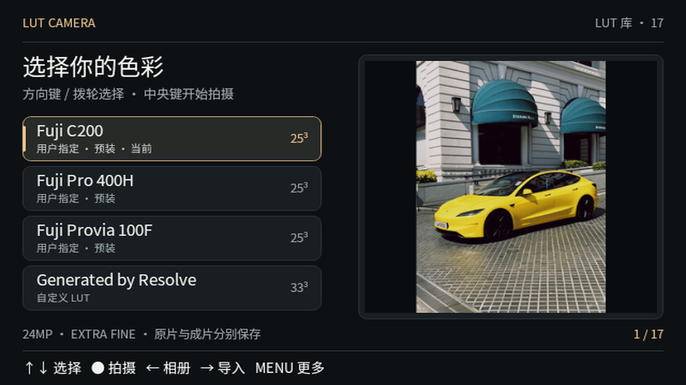

# LUT Camera 新手安装与使用教程

适用：**Sony A6300 / 固件 2.01**；当前应用版本 **0.9.0-beta.5**。先用电脑通过 USB 安装一次，以后拍摄和调色都在相机内完成。

> **[直接下载 LUT Camera beta.5 APK](https://github.com/EnglandLobster/sony-lut-camera/releases/download/v0.9.0-beta.5/SonyLutCamera-v0.9.0-beta.5.apk)**
> [发行页](https://github.com/EnglandLobster/sony-lut-camera/releases/tag/v0.9.0-beta.5) 同时提供源码包、构建信息和 SHA-256 校验文件。选择 `.apk` 安装；`Source code.zip` 是源码，不能作为安装包使用。自行编译见 [构建说明](BUILD.md)。

**操作路线：准备 APK 和安装工具 → 相机设为 MTP → 连接电脑 → 选择本地 APK 安装 → 相机里打开 LUT Camera。**

- [准备东西与相机设置](#一准备东西与相机设置)
- [Windows 安装工具](#二windows-准备安装工具)
- [macOS 安装工具](#三macos-准备安装工具)
- [连接、安装与成功确认](#四连接相机并安装)
- [第一次拍摄](#第一次拍摄) · [导入自己的 LUT](#导入自己的-lut)
- [常见问题](#常见问题) · [覆盖更新](#覆盖更新)

## 一、准备东西与相机设置

准备好以下四样：

- A6300、充足电量的电池、可正常读写且有剩余空间的 SD 卡。
- Windows 或 Mac 电脑。
- **支持数据传输的 Micro-USB 线**。只能充电的线会导致安装器找不到相机；初次安装建议直连电脑 USB 口。
- LUT Camera 的 `.apk` 文件，保存到电脑里容易找到的位置，例如“下载”文件夹。

在插 USB 线之前：

1. 打开相机电源，按 `MENU`。
2. 进入工具箱图标的 **设置**，找到 **USB 连接**，选择 **MTP**。英文菜单对应 `USB Connection → MTP`。
3. 回到相机正常界面，再连接电脑。若已插线而无法操作菜单，先拔线、设置完成后再插回。

本项目目前完成验收的是 A6300 / 2.01。其他索尼型号是否支持 PMCA 安装，可查 [上游设备列表](https://openmemories.readthedocs.io/devices.html)；支持安装应用与已验证 LUT Camera 拍摄是两件事。

## 二、Windows 准备安装工具

1. 打开 [Sony-PMCA-RE 官方 Releases](https://github.com/ma1co/Sony-PMCA-RE/releases/latest)。这是把 APK 安装到相机的电脑工具。
2. 展开发布页的 **Assets**，选择 Windows 图形界面文件。核对时上游稳定版为 v0.18，对应 **`pmca-gui-v0.18-win.exe`**。`pmca-console` 是命令行版，新手不必选它；`Source code` 也不是图形安装器。
3. 双击下载的 `.exe`，打开 PMCA 窗口。若系统给出来源提示，先核对下载地址是上述官方仓库；不需要关闭整个系统的安全防护。
4. 继续下面的 [连接相机并安装](#四连接相机并安装)。

上游说明普通 MTP 安装使用 Windows 自带驱动。此教程**不需要 Zadig，也不需要替换 USB 驱动**；那些步骤属于 PMCA 的服务模式功能。

## 三、macOS 准备安装工具

1. 打开同一个 [Sony-PMCA-RE 官方 Releases](https://github.com/ma1co/Sony-PMCA-RE/releases/latest)。
2. 在 **Assets** 中选择 **`pmca-gui-v0.18-osx.dmg`**（核对时的稳定版文件名）。打开磁盘映像，找到其中的 PMCA 图形应用；如窗口提示拖入“应用程序”，按提示操作，再打开应用。
3. 首次打开若提示开发者无法验证，确认是官方文件后，在 **系统设置 → 隐私与安全性** 中查看是否提供“仍要打开”，按系统提示确认。具体界面见 [Apple 官方说明](https://support.apple.com/zh-cn/102445)。如果提示文件损坏或不支持当前系统，先停止并记录完整提示，不用关闭 SIP 或整体停用安全检查。
4. 退出可能占用相机 USB 连接的“照片”“图像捕捉”和相机传输工具；Dropbox、Google Drive 等启用照片导入的应用也先退出。
5. 继续下面的 [连接相机并安装](#四连接相机并安装)。

上游提供的 macOS 二进制测试覆盖少于 Windows，尤其在较新的 macOS / Apple Silicon 上，能否正常启动需要按实际系统确认。若无法运行，可先用 Windows 图形工具完成安装，或把系统版本、芯片类型与完整报错发到 [Issues](https://github.com/EnglandLobster/sony-lut-camera/issues)。上游提及的 Sony Camera Driver 针对 **mass storage** 通信，本教程从 **MTP** 路径开始，不要求先安装该驱动。

## 四、连接相机并安装

Windows 与 macOS 打开 PMCA 后，按钮名称相同：

| 顺序 | 在哪里操作 | 要看到什么 |
| --- | --- | --- |
| 1 | 相机开机、MTP 模式，用数据线连接电脑 | 相机进入 USB 连接状态 |
| 2 | PMCA 的 **Camera info** 页 → **Get camera info** | 输出相机信息；若未找到设备，先处理下方连接问题 |
| 3 | 切换到 **Install app** 页 | 出现安装方式选择 |
| 4 | 选中 **Select an apk** | 使用电脑上的 APK 文件，而非在线应用列表 |
| 5 | 点击 **Open apk...** | 在“下载”等文件夹选中 LUT Camera 的 `.apk`，文件路径显示在输入框里 |
| 6 | 点击 **Install selected app** | 日志开始切换安装模式、传输并安装 |
| 7 | 等待安装任务结束 | 确认没有错误或异常提示，再断开 USB |

**LUT Camera 不必出现在 PMCA 的在线应用列表中。** 即使列表为空，也使用 `Select an apk → Open apk...` 选择你已取得的本地安装包。

安装期间让相机保持开机，暂时不要操作相机或拔线。日志出现切换安装模式、等待重新连接时，先等任务给出结果；若最终超时，按 [常见问题](#常见问题) 处理。

安装完成后：

1. 断开 USB 线。
2. 在相机打开 `MENU → 应用程序 → 应用程序列表 → LUT Camera`（英文为 `Application → Application List`）。
3. 首次启动会把预装 LUT 加入 SD 卡，等待 LUT 列表出现。
4. 能看到 **Fuji C200** 等名称、右侧参考照片，并能用上下键切换，就完成了安装与首次启动检查。



*实际 A6300 界面，已按 LCD 的 16:9 比例校正。截图中的 17 项包含这台相机此前自行导入的 LUT；新装应用预装 10 项。*

普通安装与使用不用 ADB、Telnet、“测试连接”或 Wi-Fi，也不需要先安装 OpenMemories: Tweak。PMCA 的 **Tweaks / updater mode / service mode** 不属于这次安装步骤。

<details>
<summary>已经习惯命令行？可用 pmca-console 安装</summary>

从 PMCA 官方 Releases 下载对应平台的 console 文件，将工具和 APK 放在同一文件夹，在该目录打开终端。下面的 APK 名称是示例，请换成你实际取得的文件名。

Windows PowerShell：

```powershell
.\pmca-console-v0.18-win.exe install -f ".\SonyLutCamera-v0.9.0-beta.5.apk"
```

macOS 终端：

```sh
chmod +x ./pmca-console-v0.18-osx
./pmca-console-v0.18-osx install -f "./SonyLutCamera-v0.9.0-beta.5.apk"
```

如果使用 PMCA 的 Python 源码，则先按其 README 安装 Python 3 和 `requirements.txt` 里的依赖，再执行 `python3 pmca-console.py install -f "安装包完整路径"`。这不是新手图形安装路径的必需步骤。

</details>

## 第一次拍摄

首次打开自动加入 10 个指定 LUT，默认选择 Fuji C200，可能需要等待数秒；后续打开复用已有资源。升级时自动移除旧的两项数学示例，保留其他导入项和有效选择。上下键／拨轮选 LUT，右侧参考照片显示对应效果，中央键进入拍摄。

应用为所选 LUT 自动生成近似取景参数。出现差异提示时，选「继续使用近似预览」或「使用原色取景拍摄」；这项选择不改变最终完整 LUT 调色。

半按完成对焦，再全按拍摄。半按时暂时显示原色属于当前设计，用于隔离预览参数与成片。等待保存完成后查看成片，半按返回取景。应用保留两张 24MP JPEG，分别为原片与调色成片。兼容候选版会选择机型支持的最高 JPEG 档位，并在取景信息栏显示：支持时为 EXTRA FINE；像反馈中只提供 50/25 的 A6000 则为 FINE，不需要寻找机身并不存在的额外精细选项。

左右键／拨轮调整亮度（曝光补偿），中央键归零；DISP 切换信息显示。

## 导入自己的 LUT

1. 将独立 3D `.cube` 或 `.cub` 文件复制到 SD 卡根目录的 `LUTS/`，不要放入子目录。
2. 返回应用 LUT 库，按右键扫描，选择全部或单个导入。
3. 导入完成后选择该 LUT 即可拍摄。重复内容会被识别，不覆盖导入源文件。

支持 2–65³、最大 64 MiB 的独立 CUBE。选择适用于普通已显影照片的风格表；Log 转换表需要匹配输入，不能因为扩展名相同就直接当普通照片滤镜。

应用库位于 `SONYLUT/LIBRARY/`；配对索引在 `SONYLUT/PHOTOS/`；实际拍摄文件在 `DCIM/`。复制照片直接读取 SD 卡即可。不要手动修改库内 `TABLE.BIN` 或拟合缓存。

## 回看与退出

- 播放键：应用内相册。
- 左／右：较早／较新照片。
- 中央键：原片与成片对照。
- 半按：恢复拍摄。
- MENU：回库或打开更多；选择「退出应用」返回索尼原生拍摄。

若出现错误，记录屏幕文字、版本、机型、固件与操作步骤。等待写卡指示结束后再退出；不要在保存时拔卡。若无法退出，可连接 USB，让原生 USB 模式接管，再正常断开连接。

[提交问题](https://github.com/EnglandLobster/sony-lut-camera/issues) 时不要附 Wi-Fi 密码、未经许可的 LUT 或私人原片；可先提供文字和脱敏日志。

## 覆盖更新

退出 LUT Camera 并等待写卡结束，再按同样的 MTP 安装步骤选取新 APK。**同一签名的版本可以直接覆盖安装**，不需要先卸载；原有导入 LUT 和照片保留。

如果安装器报告签名冲突，核对新包是否与之前来自同一发布来源。不要通过清空应用数据或格式化 SD 卡处理签名问题。卸载或迁移前，先用读卡器备份 `DCIM/` 和 `SONYLUT/`。

## 常见问题

| 遇到的问题 | 按这个顺序检查 |
| --- | --- |
| Releases 页面只有源码、找不到 APK | 打开本页顶部的 beta.5 发行链接并展开 Assets，选择 `.apk`；不要把源码压缩包改名为 `.apk`。 |
| PMCA 没有找到相机 | 确认相机已开机 → 拔线后确认 USB 连接是 MTP → 换支持数据的线 → 直连电脑 USB 口 → 退出占用相机的程序 → 重新点击 Get camera info。 |
| 插线后相机菜单不能操作 | 先拔 USB 线，设置 MTP 后再连接。 |
| Finder 中没有出现 SD 卡盘符 | MTP 不是普通 U 盘模式；以 PMCA 能否读取相机信息为准。复制 LUT 或照片时可以使用读卡器。 |
| PMCA 在线列表为空，或找不到 LUT Camera | 选 Select an apk，再用 Open apk... 选择本地 APK；不依赖在线列表。 |
| 安装模式切换超时 | 等任务结束，确认相机重新连接后再运行一次；仍失败则关闭 PMCA、拔线，重新按 MTP 步骤连接。保留日志中的完整错误。 |
| 安装提示相机不支持 apps | 核对机型和上游 PMCA 设备列表。不要转用固件更新或服务模式继续尝试本教程。 |
| macOS 提示无法验证开发者 | 确认官方来源后，参考上方 Apple 的“隐私与安全性”步骤；损坏、不兼容提示另行排查。 |
| 安装完成但找不到应用 | 先断开 USB，再进入相机的应用程序列表；若仍没有，检查 PMCA 日志是否真正完成安装。 |
| 首次打开较慢 | 正在向 SD 卡导入预装 LUT。等列表出现再操作；若出现错误，记录文字并检查 SD 卡空间和可写性。 |
| 导入页找不到自己的 LUT | 检查它直接位于 SD 根目录 `LUTS/`，扩展名为 `.cube` / `.cub`，不是未解压的 ZIP 或子目录。 |
| 取景颜色与成片不同 | 取景为矩阵/Gamma 近似；成片按完整 LUT 计算。可在更多菜单切换当前 LUT 的取景方式。 |

仍有问题时，在 [Issues](https://github.com/EnglandLobster/sony-lut-camera/issues) 提供：相机型号和固件、Windows/macOS 版本（Mac 也注明 Intel / Apple 芯片）、PMCA 版本、LUT Camera 版本、出错步骤和完整报错。日志中的相机序列号等个人信息可先遮盖。

## 教程依据与验证范围

安装工具文件名及按钮名称于 2026-10-31 按 [PMCA 上游说明](https://github.com/ma1co/Sony-PMCA-RE#installation)、[v0.18 发布资源](https://github.com/ma1co/Sony-PMCA-RE/releases/tag/v0.18) 和 [安装界面源码](https://github.com/ma1co/Sony-PMCA-RE/blob/v0.18/pmca-gui.py) 核对。macOS 的来源确认步骤参考 [Apple 官方文档](https://support.apple.com/zh-cn/102445)。

LUT Camera 已在 A6300 / 固件 2.01 完成安装、启动及实拍验证；本次教程更新未重新执行 Windows/macOS 各版本的全新 MTP 安装验收。图中为实际机内界面，PMCA 操作表为文字指引。
